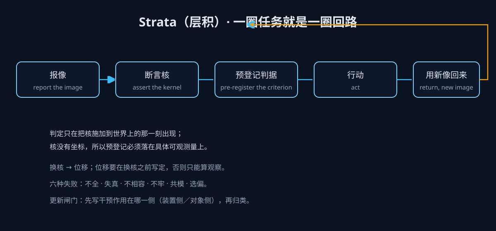

# Strata

Strata is a discipline for how an agent works, not a new tool. Every task is one turn of the same
loop: say what the image is and where it came from, state the kernel that decides which differences
are merged, write down the criterion **before** acting, act, then come back with the new image.

What it adds beyond a normal preset:

- **A gate on length.** A reversible local change gets one line of conclusion. Anything irreversible,
  or any claim meant to hold across versions, levels, or scopes, gets the full loop.
- **A vocabulary for failure.** Narrow kernel, distortion, no solution, instability, wrong forward
  model, and selection bias — each with the probe that can separate it from its neighbours.
- **An update gate.** Before a new image enters the model, the intervention side is written down
  (device side or object side), and the finding is filed as artifact, illusion, real, or undetermined.
- **A one-way pair discipline.** What is forbidden is a return, not a reading; the reverse path is
  bounded by an epsilon written before the kernel changes.

The preset mounts the per-agent tool surface (files, shell and persistent terminal, jobs, schedule,
skills, goals, plan mode, compaction, subagents / workflow / ralph, session query, web, todo) and
declares no Host services. It is configuration only: no install scripts, no runtime dependencies.

Compatible with dsh `>= 0.2.2-rc.3`. The mode takes effect in a new session that selects it; existing
sessions keep the plugin revision they started with.
