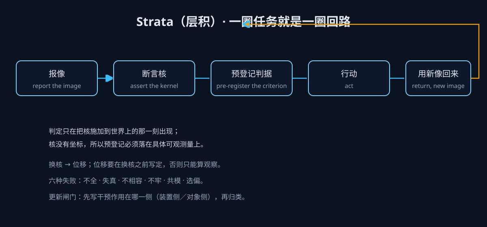

# Strata 层积

Strata 不是一套新工具，而是一份关于「怎么干活」的纪律。每个任务都是同一条回路的一圈：先说清像
是什么、从哪来；再断言核——哪些差别被合并、哪些被分开；在动手**之前**把判据写下来；动手；然后
带着新像回来。

它比普通模式多出来的几样：

- **一条长度门槛。** 可回滚的局部改动只写一行结论；一旦不可逆，或要写成跨版本、跨层级、跨作用域
  的结论，才走全套——报像、断言核、预登记判据、给归类。
- **一套失败词汇。** 狭窄、畸变、无解、不稳定、前向模型错、选择偏差；每一个都配着能把它与邻居分开
  的那支探针。
- **一道更新闸门。** 新像进不进模型，先写清干预作用在装置侧还是对象侧，再归成伪影、假象、真象或
  未定。
- **单向对的写法。** 被禁止的是「返回」，不是读数；反向路径由一条在换核之前写定的上界 ε 限定。

本 preset 挂载 per-agent 的工具面（文件、shell 与持久终端、后台任务、定时、技能、目标、计划模式、
压缩、子代理／workflow／ralph、会话查询、web、todo），不声明任何 Host 服务。它只是配置：没有安装
脚本，没有运行时依赖。

兼容 dsh `>= 0.2.2-rc.3`。模式只在**选中它的新会话**里生效；已有会话保持启动时的插件版本。
